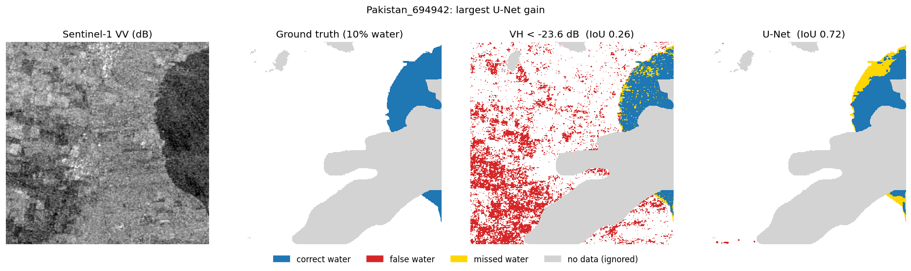
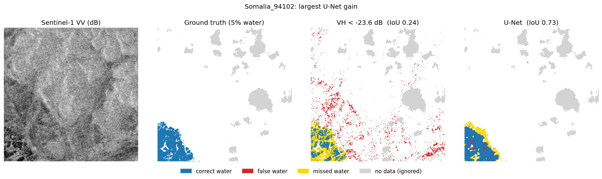
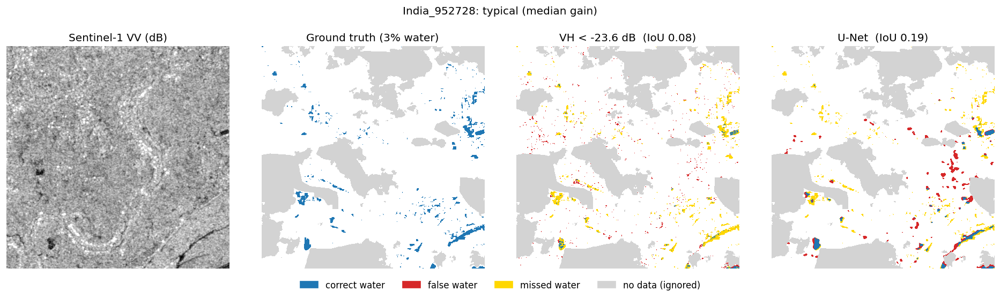
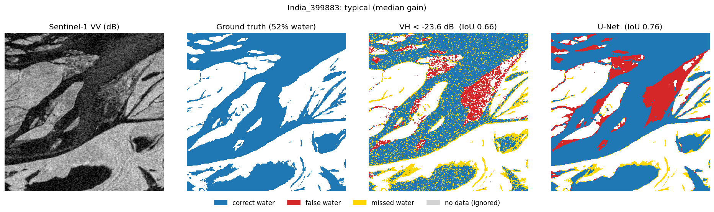
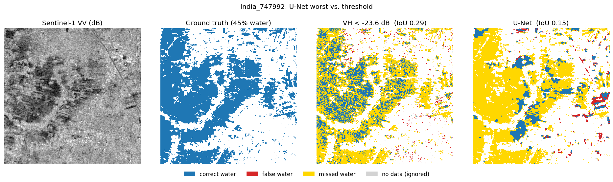
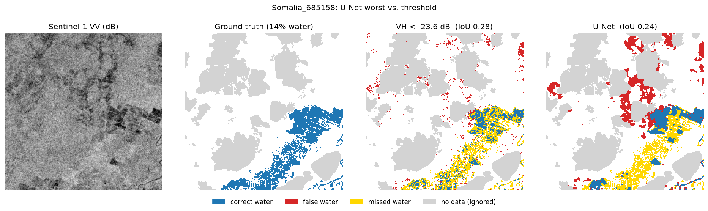

# sar-flood-unet

U-Net vs. threshold baselines for Sentinel-1 flood segmentation on the hand-labelled Sen1Floods11 dataset.

A U-Net (ResNet34 encoder, PyTorch) trained on Sentinel-1 VV and VH backscatter reaches **IoU 0.675** on the official test split, against **0.592** for the best speckle-filtered dB threshold (0.533 without filtering). On the held-out Bolivia event, which no method saw during development, the filtered threshold does better than the U-Net (**0.617 vs. 0.576**).

**In plain terms:** Sentinel-1 is a radar satellite that can see through clouds, day and night. Calm water reflects the radar signal away from the satellite, so floods look dark in its images. The simplest way to map a flood is to call every pixel darker than a chosen value "water" (a *threshold*). This project tests whether a deep-learning model that also looks at shapes and surroundings does better. Results are scored with *IoU* (intersection over union): the overlap between the mapped water and the true water, from 0 (no overlap) to 1 (perfect match). Other terms are explained in the [glossary](#glossary).



## Results

All methods are scored on exactly the same pixels: unlabelled pixels and pixels with missing SAR data are excluded (see [Evaluation](#evaluation)). Metrics are for the water class, pooled over all pixels of a split.

**Test split** (90 chips, 10 flood events)

| Method | IoU | F1 | Precision | Recall |
|---|---|---|---|---|
| Otsu on VV, per chip | 0.211 | 0.349 | 0.230 | 0.727 |
| Fixed threshold VV < −16.8 dB | 0.464 | 0.634 | 0.774 | 0.536 |
| Lee 5×5, VV < −15.8 dB | 0.486 | 0.654 | 0.804 | 0.552 |
| Median 5×5, VV < −16.1 dB | 0.493 | 0.661 | 0.805 | 0.560 |
| Fixed threshold VH < −23.6 dB | 0.533 | 0.695 | 0.747 | 0.650 |
| Lee 5×5, VH < −23.0 dB | 0.585 | 0.738 | 0.809 | 0.678 |
| Median 5×5, VH < −23.3 dB | 0.592 | 0.744 | 0.812 | 0.687 |
| **U-Net (ResNet34)** | **0.675** | **0.806** | **0.819** | **0.793** |

**Bolivia hold-out** (15 chips, one event not used for training or model selection)

| Method | IoU | F1 | Precision | Recall |
|---|---|---|---|---|
| Otsu on VV, per chip | 0.350 | 0.519 | 0.378 | 0.826 |
| Fixed threshold VV < −16.8 dB | 0.436 | 0.608 | 0.881 | 0.464 |
| Median 5×5, VV < −16.1 dB | 0.515 | 0.680 | 0.911 | 0.542 |
| Lee 5×5, VV < −15.8 dB | 0.516 | 0.680 | 0.907 | 0.544 |
| Fixed threshold VH < −23.6 dB | 0.535 | 0.697 | 0.870 | 0.581 |
| U-Net (ResNet34) | 0.576 | 0.731 | 0.799 | **0.674** |
| Lee 5×5, VH < −23.0 dB | 0.612 | 0.759 | 0.909 | 0.652 |
| **Median 5×5, VH < −23.3 dB** | **0.617** | **0.763** | **0.914** | 0.655 |

Main points:

- **Speckle filtering matters.** A 5×5 median or Lee filter before thresholding raises test IoU from 0.533 to 0.592 (VH), closing about 40% of the gap between the unfiltered threshold and the U-Net. Part of what the U-Net learns is, in effect, speckle suppression.
- **On the test split the U-Net is still clearly better**: +0.083 IoU over the best filtered threshold, with higher recall (0.79 vs. 0.69) at similar precision (0.82 vs. 0.81). It beats the filtered threshold on 9 of 10 test events; the exception is Sri Lanka (0.801 vs. 0.858).
- **On the unseen Bolivia event the filtered threshold is better** (0.617 vs. 0.576), mainly through precision (0.91 vs. 0.80). The thresholds score similarly on test and Bolivia; the U-Net drops from 0.675 to 0.576. The learned model transfers less well to a new event than a simple physical rule. Bolivia is one event of 15 chips, so the size of this effect is uncertain, but it is a reason to validate on local labelled data before using such a model in a new basin.
- VH separates water better than VV on this dataset, with or without filtering, although many workflows threshold VV by default.

**Test IoU per flood event**

| Event | Chips | Fixed VV | Fixed VH | Median 5×5 VH | U-Net |
|---|---|---|---|---|---|
| Nigeria | 4 | 0.696 | 0.713 | 0.785 | 0.889 |
| Mekong | 6 | 0.739 | 0.724 | 0.741 | 0.830 |
| Sri Lanka | 9 | 0.203 | 0.717 | **0.858** | 0.801 |
| Spain | 6 | 0.621 | 0.640 | 0.674 | 0.732 |
| India | 14 | 0.636 | 0.593 | 0.650 | 0.669 |
| Paraguay | 14 | 0.494 | 0.466 | 0.490 | 0.659 |
| Ghana | 11 | 0.387 | 0.453 | 0.474 | 0.582 |
| USA | 14 | 0.327 | 0.379 | 0.500 | 0.582 |
| Somalia | 6 | 0.179 | 0.256 | 0.278 | 0.471 |
| Pakistan | 6 | 0.117 | 0.150 | 0.151 | 0.311 |

Several events have only 4–6 test chips, so single-event values are indicative only.

## Examples

Six test chips, chosen by a fixed rule rather than by eye: among test chips with at least 2% water, the two with the largest U-Net gain over the unfiltered VH threshold, the two at the median gain, and the two where the U-Net does worst relative to the threshold ([selection table](results/example_selection.csv)). Against the unfiltered VH threshold, the U-Net is better on 42 of these 46 chips.

Columns: Sentinel-1 VV (dB) · hand label · VH threshold errors · U-Net errors.
Blue = water found, red = false water, gold = missed water, grey = no label (ignored).

**Largest U-Net gain**




**Typical (median gain)**




**U-Net worse than the threshold**




## What the errors show

1. **Threshold errors are scattered pixels; U-Net errors are whole regions.** The unfiltered threshold judges each pixel on its own, so speckle produces salt-and-pepper noise, both false water on dark land and gaps inside real water. A speckle filter removes part of this noise (see the filtered-threshold results above); the U-Net goes further and produces connected, smoother water bodies. When it is wrong, though, it is wrong over whole patches (India_399883, Somalia_685158).
2. **Most of the gain comes from removing false alarms on dark land.** In arid or bare-field scenes (Somalia_94102, Pakistan_694942), the threshold marks large dark areas as water; the U-Net largely ignores them.
3. **Neither method finds water that does not look dark.** In India_747992, 45% of the chip is labelled water but most of it has moderate VV backscatter with a field pattern, probably flooded vegetation or crops. The threshold catches some of it pixel by pixel; the U-Net misses almost all of it. This matches the training-set histogram, where labelled water has a second VV mode around −12 dB that overlaps the land distribution. A single post-event intensity image cannot separate these pixels; a pre-event image (change detection) would be the natural next step.
4. **Small, scattered water bodies remain hard** (India_952728: IoU 0.08 → 0.19).
5. **Some disagreements may be label errors.** The hand labels were traced on Sentinel-2 imagery, which is not always from the same date as the Sentinel-1 scene. In India_399883 both methods mark the same dark area as water where the label says land.

Per-chip Otsu performs poorly because most chips contain too little water for a bimodal VV histogram. Below about 10% water, Otsu splits the land distribution instead (thresholds around −7 to −13 dB), giving precision 0.23. Most chips with roughly 20–75% water get thresholds between −14 and −16 dB, close to the train-optimised fixed threshold. This is a naive per-chip Otsu; scene-level or bimodality-checked variants used operationally would do better.

## Data

[Sen1Floods11](https://github.com/cloudtostreet/Sen1Floods11) (Bonafilia et al., 2020), hand-labelled subset: 446 Sentinel-1 GRD chips of 512 × 512 pixels at 10 m from 11 flood events, with labels 1 = water, 0 = not water, −1 = no data. Bands are VV and VH in dB, preprocessed by the dataset authors in Google Earth Engine.

The official splits are used unchanged: train 252, validation 89, test 90, Bolivia 15.

| Split | Water share of labelled pixels |
|---|---|
| train | 9.5% |
| validation | 11.0% |
| test | 12.5% |
| Bolivia | 15.9% |

Data are downloaded from the public bucket `gs://sen1floods11` and are not included in this repository.

## Methods

**Thresholds** ([02_baseline.ipynb](notebooks/02_baseline.ipynb))
- *Otsu on VV, per chip:* threshold computed from each chip's own VV histogram; no labels used.
- *Fixed VV and VH thresholds:* swept from −40 to +5 dB in 0.1 dB steps on the **train split only**; the value with the best pooled IoU is kept (VV −16.8 dB, VH −23.6 dB) and applied unchanged to the other splits.
- *Speckle-filtered thresholds* ([05_extra_baselines.ipynb](notebooks/05_extra_baselines.ipynb), [src/filters.py](src/filters.py)): each band filtered with a 5×5 Lee filter (in linear power, nominal ENL 4.4 for Sentinel-1 IW GRDH) or a 5×5 median filter, then a threshold re-tuned on train in the same way. The median-filtered VH threshold has the best train IoU (0.511, vs. 0.502 for Lee), so it is the filtered baseline used in the per-event table.

**U-Net** ([03_unet_training.ipynb](notebooks/03_unet_training.ipynb), [src/](src))
- `segmentation_models_pytorch` U-Net, ResNet34 encoder initialised from ImageNet, 2 input channels (VV, VH), 1 output channel.
- Input: each band clipped to the 0.5–99.5 percentile range of train pixels (VV −25.7 to −0.8 dB, VH −38.1 to −8.4 dB) and scaled to 0–1; missing values set to 0 and excluded from the loss.
- Loss: binary cross-entropy + Dice, computed on labelled pixels only ([src/losses.py](src/losses.py)).
- Augmentation: random horizontal and vertical flips and 90° rotations.
- Adam, learning rate 3e-4 with cosine decay, batch size 8, 40 epochs (~23 s per epoch on a free Colab T4 GPU).
- The checkpoint with the best validation IoU is kept (epoch 32, validation IoU 0.681). The test split was used once, after training.
- Prediction: water where the predicted probability is above 0.5.

Training curves are in [results/unet_training_log.csv](results/unet_training_log.csv). GPU training is not fully deterministic, so a re-run may differ slightly.

### Evaluation

([04_evaluation.ipynb](notebooks/04_evaluation.ipynb), [src/metrics.py](src/metrics.py))

- A pixel is scored only if it has a label (not −1) and both VV and VH are present. One test chip (Paraguay_34417) contains no Sentinel-1 data; together with scattered missing pixels this removes 0.36% of labelled test pixels, identically for every method.
- IoU, F1, precision and recall are computed for the water class from confusion counts pooled over all pixels of a split. Pooling avoids undefined per-chip IoU on the 7 test chips without water.
- Accuracy is reported in the CSVs but not used for comparison: with 12.5% water, predicting "no water" everywhere already gives 0.875 accuracy.

## Repository structure

```
notebooks/
  00_setup_check.ipynb     Colab GPU and library check
  01_explore_data.ipynb    download, inspection, histograms, clip percentiles
  02_baseline.ipynb        Otsu and fixed-threshold baselines
  03_unet_training.ipynb   U-Net training
  04_evaluation.ipynb      test / Bolivia evaluation, per-event results, figures
  05_extra_baselines.ipynb speckle-filtered (Lee, median) threshold baselines
src/
  dataset.py               PyTorch Dataset: loading, clipping, masking, augmentation
  filters.py               NaN-tolerant Lee and median speckle filters
  losses.py                BCE + Dice loss that ignores unlabelled pixels
  metrics.py               valid-pixel mask and pooled IoU / F1 / precision / recall
results/                   metric CSVs (baselines, U-Net, per event, per chip, training log)
figures/                   example figures
```

## Reproducing

The notebooks run on Google Colab (free T4 GPU). Run them in order; `01_explore_data.ipynb` downloads the hand-labelled chips and split files (~730 MB) to `MyDrive/sen1floods11` on Google Drive, and the later notebooks clone this repository to import `src/`. Package versions are listed in [requirements.txt](requirements.txt).

## Glossary

**Satellite and radar**

| Term | Meaning |
|---|---|
| Sentinel-1 | Pair of European Space Agency radar satellites (Copernicus programme) whose images are free to use. |
| SAR | Synthetic aperture radar. The satellite sends microwave pulses and records the echo, so it works at night and through clouds. |
| Backscatter | The share of the radar signal that returns to the satellite. Calm water returns very little and looks dark; rough or built-up surfaces look bright. |
| dB | Decibel, the logarithmic unit used for backscatter. More negative values are darker. |
| VV, VH | Polarisations. VV: the signal is sent and received vertically. VH: sent vertically, received horizontally; more sensitive to vegetation. |
| IW GRD | Interferometric Wide swath, Ground Range Detected: the standard Sentinel-1 image product used here. |
| Speckle | Grainy noise that is always present in radar images, even over uniform surfaces. |
| Lee filter | Classic radar speckle filter: smooths each pixel towards its neighbours' average, strongly in flat areas and weakly at edges. |
| Median filter | Replaces each pixel with the middle value of its neighbourhood (here 5 × 5 pixels). |
| ENL | Equivalent number of looks: a measure of how strong the speckle is; the Lee filter needs it as a setting. |

**Data and evaluation set-up**

| Term | Meaning |
|---|---|
| Sen1Floods11 | Public benchmark dataset of Sentinel-1 flood images from 11 flood events, with water masks. |
| Chip | One image tile, 512 × 512 pixels at 10 m, about 5 × 5 km. |
| Hand-labelled | Water drawn by a person (here using optical Sentinel-2 images as a guide), rather than by an algorithm. |
| No data (−1) | Pixels without a label (often clouds in the optical guide image) or without radar data. They are ignored in all scores. |
| Train / validation / test split | Data used to fit a method / to choose settings / to measure the final result. Keeping them separate prevents over-optimistic scores. |
| Hold-out (Bolivia) | An extra test set from a flood event that appears in no other split, to see how methods work on a new event. |
| Pooled | Scores computed from all pixels of a split together, rather than averaged per chip. |

**Methods**

| Term | Meaning |
|---|---|
| Threshold | Rule "water if backscatter is below X dB". |
| Otsu | Automatic method (Nobuyuki Otsu, 1979) that picks the threshold that best splits an image's brightness histogram into two groups. |
| Deep learning | Machine learning with neural networks: many layers of simple calculations whose settings (weights) are learned from examples. |
| Segmentation | Assigning a class (here water / not water) to every pixel of an image. |
| U-Net | A neural network for segmentation (Ronneberger et al., 2015). It shrinks the image to recognise patterns, then enlarges it back to full size; "skip connections" carry fine detail across, giving the U shape. |
| ResNet34 | A well-known 34-layer image network, used as the pattern-recognising half (the *encoder*) of the U-Net. |
| ImageNet weights | Weights learned on ImageNet, a large collection of everyday photos, used as a starting point instead of random values. |
| Loss | The error score that training tries to reduce. |
| BCE | Binary cross-entropy: a loss that scores each pixel's predicted probability against its label. |
| Dice | A loss based on the overlap between predicted and true water areas, closely related to IoU. |
| Augmentation | Randomly flipping and rotating training images so the model sees more variety. |
| Epoch | One full pass through all training chips. |
| Adam, learning rate | Adam is a standard algorithm for adjusting the weights during training; the learning rate is the size of each adjustment. |
| Checkpoint | Saved copy of the model's weights, here from the epoch with the best validation score. |

**Scores**

| Term | Meaning |
|---|---|
| IoU | Intersection over union: overlap of mapped and true water divided by their combined area. 1 = perfect. Main score used here. |
| Precision | Of the pixels mapped as water, the share that really is water. Low precision = many false alarms. |
| Recall | Of the real water, the share that was found. Low recall = much water missed. |
| F1 | Single score combining precision and recall (their harmonic mean). |
| Accuracy | Share of all pixels classified correctly. Misleading here because most pixels are not water. |

**Tools**

| Term | Meaning |
|---|---|
| Python | Programming language used throughout. |
| PyTorch | Python library for building and training neural networks. |
| segmentation_models_pytorch | Python library providing ready-made U-Net and similar models. |
| Google Colab | Free online Python notebooks from Google, with access to a GPU. |
| GPU (T4) | Graphics processor that speeds up neural-network training; Colab's free tier provides an NVIDIA T4. |
| Notebook (.ipynb) | A document mixing code, its output and explanations. |
| CSV | Plain-text table file, readable in Excel. |

## Citation

Bonafilia, D., Tellman, B., Anderson, T., Issenberg, E. (2020). Sen1Floods11: a georeferenced dataset to train and test deep learning flood algorithms for Sentinel-1. *IEEE/CVF Conference on Computer Vision and Pattern Recognition (CVPR) Workshops*, pp. 210–211.

## Licence

Code: MIT (see [LICENSE](LICENSE)). The Sen1Floods11 data are not redistributed here; figures are derived from the dataset, credited above.

## About

Ronnel Pabalan, flood modeller. I use Sentinel-1 for flood mapping in my work and built this project to learn deep learning for SAR segmentation and to compare it honestly with the threshold methods used in practice.
